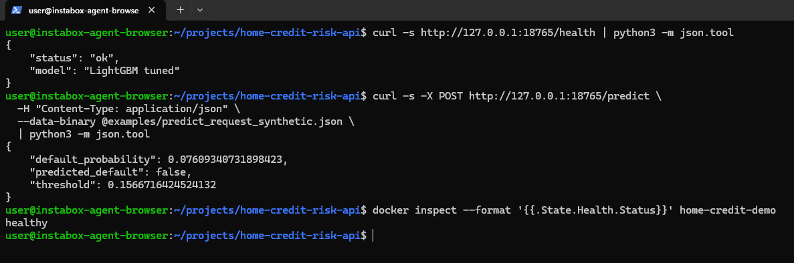

# Home Credit Default Risk Prediction

**Machine Learning Zoomcamp 2026 — Midterm Project | DataTalks.Club**
Course repository: [DataTalksClub/machine-learning-zoomcamp](https://github.com/DataTalksClub/machine-learning-zoomcamp)

An educational project that predicts whether a loan applicant may have difficulty repaying a loan, using the [Home Credit Default Risk competition](https://www.kaggle.com/competitions/home-credit-default-risk) training data. It compares Logistic Regression, Random Forest, XGBoost, and LightGBM, and serves the selected LightGBM pipeline through FastAPI and Docker. The project uses Python, scikit-learn, and `uv` for dependency management. It is an independent course project and is not endorsed or certified by DataTalks.Club. It is for learning only, not real credit decisions.

## Contents

- [Project overview](#project-overview)
- [Problem description](#problem-description)
- [Dataset](#dataset)
- [Exploratory data analysis](#exploratory-data-analysis)
- [Model training and selection](#model-training-and-selection)
- [Results](#results)
- [Project structure](#project-structure)
- [Quick start: Docker](#quick-start-docker)
- [API usage](#api-usage)
- [API Demo](#api-demo)
- [Reproducing training and experiments](#reproducing-training-and-experiments)
- [ML Zoomcamp rubric alignment](#ml-zoomcamp-rubric-alignment)
- [Limitations and responsible use](#limitations-and-responsible-use)
- [References](#references)

## Project overview

The repository contains an executed analysis notebook, reproducible training scripts, serialized model pipelines, a 120-field request schema, a FastAPI prediction service, Docker packaging, and automated tests. LightGBM is the production default; the preserved XGBoost model can be selected with an environment variable.

## Problem description

The target is `TARGET=1` when an applicant had difficulty repaying a loan. Missing a positive case (a false negative) can overlook repayment difficulty; flagging a negative case (a false positive) can incorrectly identify an applicant as high risk. The positive class is about **8.07%** of the data, so the project reports Average Precision (AP), which focuses on positive-class retrieval, alongside ROC-AUC, which summarizes ranking over thresholds. Neither metric establishes calibration or whether a model is suitable for lending.

## Dataset

The project uses only `application_train.csv` from the [Kaggle Home Credit Default Risk competition](https://www.kaggle.com/competitions/home-credit-default-risk); no auxiliary competition tables are used. A Kaggle account and acceptance of competition rules may be required. Download the authorized training CSV and place it at `data/raw/application_train.csv`. That directory is ignored by Git and the dataset is not included in this repository.

This competition dataset is distinct from the course's Module 6 CreditScoring dataset. Their schemas, populations, and results are not interchangeable. The notebook and training code use applicant fields as predictors while excluding `TARGET` and `SK_ID_CURR` from model input.

## Exploratory data analysis

The [executed notebook](notebook.ipynb) includes dataset shape and types, missingness, duplicate checks, target distribution, numerical distributions, and feature-importance views. It contains aggregate analysis and plots, not individual applicant records. Feature associations and model importance are descriptive, not causal.

## Model training and selection

The notebook compares a Logistic Regression baseline, two Random Forest configurations, and two XGBoost configurations on a fixed stratified validation partition. Subsequent experiments add engineered features, compare XGBoost and LightGBM candidates, and confirm candidates with three-fold stratified cross-validation on the training partition. The experiment protocol, parameters, and limitations are in [experiments/REPORT.md](experiments/REPORT.md); machine-readable records are in [`experiments/`](experiments/).

The selected LightGBM pipeline calculates engineered financial features internally, applies leakage-safe preprocessing, and supports missing values and unknown categories. Its threshold was selected by maximum F1 on the fixed validation split. The final approved artifact was fitted on train plus validation; the held-out test partition was not used to select or report LightGBM performance. Validation threshold optimization can be optimistic and is not an unbiased estimate of future performance.

## Results

Metrics below are taken from the saved notebook, experiment records, and reports. AP means Average Precision. Validation and cross-validation results are model-selection evidence; the XGBoost test result is a separate historical final evaluation and must not be compared as though measured on the same partition.

| Model / configuration | Evidence and partition | ROC-AUC | AP | Additional recorded result |
|---|---|---:|---:|---|
| Logistic Regression baseline | Re-executed notebook, validation | 0.7468 | 0.2271 | — |
| Random Forest 1 | Re-executed notebook, validation | 0.7381 | 0.2239 | — |
| Random Forest 2 | Re-executed notebook, validation | 0.7394 | 0.2230 | — |
| XGBoost 2, 180 trees | Historical Phase 2 validation reference | 0.755089 | 0.243390 | Frozen production threshold: 0.161378 |
| XGBoost 2, 180 trees | Re-executed notebook, validation | 0.755400 | 0.244557 | Diagnostic validation F1 threshold: 0.151809; not the production threshold |
| XGBoost, refit on train + validation | Historical held-out test evaluation | 0.760728 | 0.247628 | Precision 0.262045, recall 0.376838 at threshold 0.161378 |
| Tuned LightGBM + engineered features | Fixed validation split | **0.767261** | **0.256644** | Precision 0.251589, recall 0.422558, F1 0.315394 at threshold 0.156672 |
| Tuned LightGBM + engineered features | Three-fold CV on training partition, mean ± SD | 0.762720 ± 0.001538 | 0.245235 ± 0.005388 | Same three folds used for all candidates |

The historical and re-executed XGBoost validation values differ slightly. The discrepancy is documented in the [experiment report](experiments/REPORT.md); the available records do not establish its cause. Historical XGBoost results and the approved artifacts and thresholds were preserved. No LightGBM test score is reported.

## Project structure

```text
.
├── notebook.ipynb                 # EDA, validation comparisons, plots
├── train_lightgbm.py               # Selected LightGBM training pipeline
├── train.py                        # Preserved XGBoost training and historical test evaluation
├── predict.py                      # FastAPI application and model selection
├── credit_features.py              # Serializable production feature transformer
├── feature_schema.json             # 120-field API schema and feature types
├── models/
│   ├── lightgbm_home_credit.joblib  # Default production pipeline
│   └── xgb_home_credit.joblib       # XGBoost fallback pipeline
├── examples/
│   ├── predict_request_synthetic.json
│   └── predict_request.json         # All-null missing-value example
├── experiments/REPORT.md           # Validation/CV protocol and findings
├── reports/lightgbm_validation.json
├── tests/                           # Dataset-independent API/model tests
├── Dockerfile
├── pyproject.toml
└── uv.lock
```

## Quick start: Docker

Docker runs the included model artifacts and does not need the Kaggle CSV. From the repository root, build and start the LightGBM API:

```bash
docker build -t home-credit-risk-api:lightgbm .
docker run --rm -d --name home-credit-lightgbm \
  -p 127.0.0.1:8000:8000 home-credit-risk-api:lightgbm
```

The image uses Python 3.11, installs locked runtime dependencies with `uv`, includes CPU inference dependencies, and runs as a non-root user. The feature transformer and both model artifacts are included. The API has a Docker health check.

## API usage

Health check:

```bash
curl http://127.0.0.1:8000/health
```

Make a prediction with the committed synthetic example:

```bash
curl -X POST http://127.0.0.1:8000/predict \
  -H 'Content-Type: application/json' \
  --data-binary @examples/predict_request_synthetic.json
```

`POST /predict` accepts the original 120 application fields. Send missing values as JSON `null`; `TARGET`, `SK_ID_CURR`, missing fields, and extra fields are rejected. A successful response includes `default_probability`, `predicted_default`, and `threshold`.

To use the preserved XGBoost model instead, start a second container on another local port:

```bash
docker run --rm -d --name home-credit-xgboost \
  -e HOME_CREDIT_MODEL=xgboost \
  -p 127.0.0.1:8001:8000 home-credit-risk-api:lightgbm
curl http://127.0.0.1:8001/health
curl -X POST http://127.0.0.1:8001/predict \
  -H 'Content-Type: application/json' \
  --data-binary @examples/predict_request_synthetic.json
docker stop home-credit-xgboost
```

Stop the default LightGBM container when finished:

```bash
docker stop home-credit-lightgbm
```

## API Demo

The screenshot shows a local Docker demonstration: `GET /health`, `POST /predict` using synthetic request data, and the container reporting a healthy status. This is a local Docker demo, not a public cloud deployment.



## Reproducing training and experiments

Install Python 3.11 and [`uv`](https://docs.astral.sh/uv/), download the authorized CSV as described in [Dataset](#dataset), then install the locked development dependencies:

```bash
uv sync --locked --group dev
```

Reproduce the development-only LightGBM validation selection and final train-plus-validation fit with:

```bash
uv run python train_lightgbm.py
```

This script selects a threshold on validation, fits the final pipeline on train plus validation, and does not evaluate the held-out test partition. It writes the model artifact and validation record at the paths listed in [Project structure](#project-structure).

Run the notebook from the repository root:

```bash
uv run jupyter nbconvert --to notebook --execute --inplace \
  --ExecutePreprocessor.timeout=900 notebook.ipynb
```

The notebook reproduces EDA and training/validation experiments; it does not calculate held-out test metrics. The experiments scripts can be run as described in [experiments/README.md](experiments/README.md). To check the dataset-independent test suite without training data:

```bash
uv run pytest -q
```

`train.py` preserves the historical XGBoost workflow and calculates its recorded final test evaluation. Do not rerun that test evaluation for model selection; the committed result is documented separately in [Results](#results) and `reports/test_metrics.json` is generated locally, not tracked.

## ML Zoomcamp rubric alignment

This table maps the [official project guidance and evaluation criteria](https://github.com/DataTalksClub/machine-learning-zoomcamp/blob/main/projects/README.md) to repository evidence. It describes what is present and does not assign a score or predict a review outcome.

| Criterion | Project evidence |
|---|---|
| Problem description and run instructions | [Problem description](#problem-description), [Dataset](#dataset), [Quick start](#quick-start-docker), and [API usage](#api-usage) |
| EDA and feature analysis | [`notebook.ipynb`](notebook.ipynb): target distribution, missingness, numerical distributions, and feature-importance analysis |
| Multiple models and tuning | [`notebook.ipynb`](notebook.ipynb) and [`experiments/REPORT.md`](experiments/REPORT.md): Logistic Regression, Random Forest, XGBoost, LightGBM, feature experiments, and CV |
| Training logic in scripts | [`train_lightgbm.py`](train_lightgbm.py); [`train.py`](train.py) preserves the XGBoost workflow |
| Reproducibility and data access | [Dataset](#dataset), [`pyproject.toml`](pyproject.toml), [`uv.lock`](uv.lock), committed aggregate notebook outputs, and dataset-independent tests |
| Model service | [`predict.py`](predict.py): FastAPI `/health` and `/predict` endpoints |
| Dependencies and environment | [`pyproject.toml`](pyproject.toml), [`uv.lock`](uv.lock), and [Reproducing training and experiments](#reproducing-training-and-experiments) |
| Containerization | [`Dockerfile`](Dockerfile) and [Docker instructions](#quick-start-docker) |
| Cloud deployment | Not implemented. The service has been tested locally in Docker; no public cloud endpoint or deployment screenshot is claimed. |

The Kaggle competition CSV is not committed because it is governed by Kaggle's access rules. The course's Module 6 CreditScoring dataset is separate and is not used here.

## Limitations and responsible use

- The validation-selected LightGBM threshold and reported validation metrics are selection estimates and may be optimistic. Three-fold CV provides additional development evidence, not an independent test result.
- The historical XGBoost test result belongs to a separate fitted model and partition; it is not directly comparable to LightGBM validation or CV metrics. The XGBoost validation discrepancy is unresolved and disclosed above and in the experiment report.
- Removing `CODE_GENDER` in a validation sensitivity check is not a fairness evaluation. Proxy variables, subgroup error rates, calibration, consent, and the effects of deployment have not been adequately assessed.
- Model importance and feature associations do not imply causation. The project does not assess whether its probabilities are calibrated or appropriate for any lending decision.
- This is an educational project only. Do not use it to approve, deny, price, or otherwise make decisions about real credit applications.

## References

- [DataTalks.Club Machine Learning Zoomcamp](https://github.com/DataTalksClub/machine-learning-zoomcamp)
- [Official midterm project guidance and rubric](https://github.com/DataTalksClub/machine-learning-zoomcamp/blob/main/projects/README.md)
- [Kaggle Home Credit Default Risk competition](https://www.kaggle.com/competitions/home-credit-default-risk)
- [Experiment protocol and detailed results](experiments/REPORT.md)
